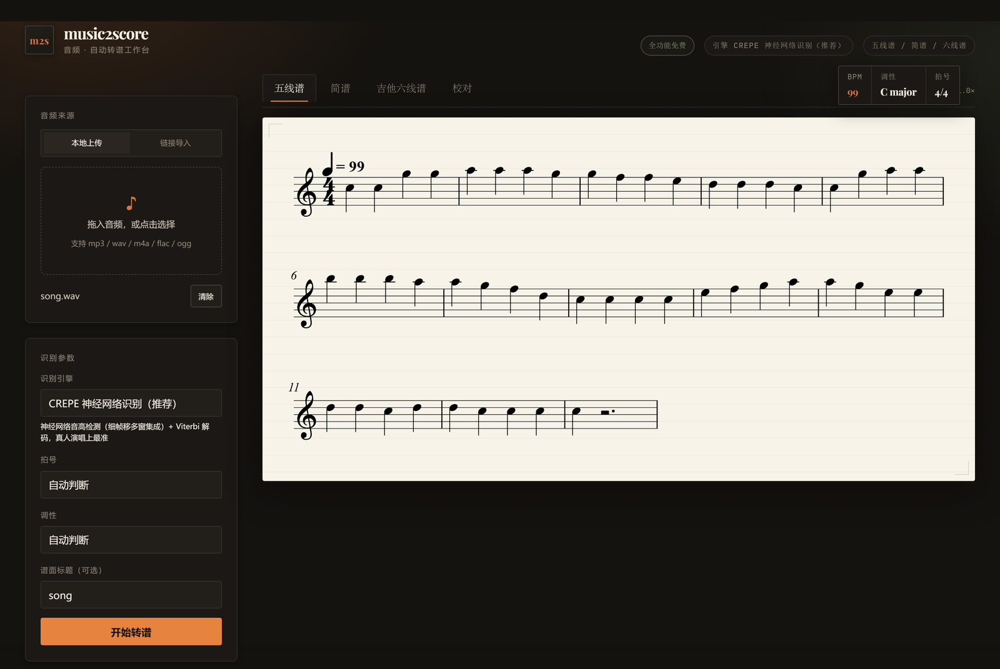
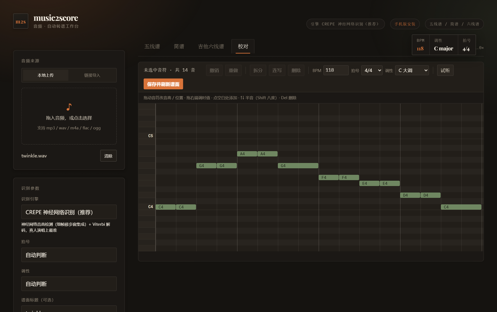

# music2score · 上传音乐或粘贴链接，自动转成乐谱

[](LICENSE)

**产品主页（安装指南）**：https://sy666520.github.io/M2S/ · [安装页](https://sy666520.github.io/M2S/install.html)

一个**纯本地运行**的 Web 应用：上传一段音频（或粘贴抖音 / B 站等视频链接），自动识别旋律，
生成**五线谱、简谱、吉他六线谱**，可试听核对、在线人工校对，并导出 MIDI / MusicXML。



> 定位：把你从"听写音符"里解放出来的**初稿工具**。识别完直接在页面里改错音，
> 十分钟内得到一份能用的谱子，而不是"一键出完美成品"。

---

## 1. 这个项目解决什么问题

### 痛点

1. **扒谱极其费时。** 听到一段想弹、想唱、想改编的旋律，手动听写要几小时；对不熟视唱的人几乎做不了。
2. **云端产品不好用。** 现有服务要么按年订阅、要么限制时长、要么必须把音频传到别人的服务器；
   而且绝大多数**不出简谱**——国内弹唱、教学场景里简谱才是刚需。
3. **隐私与版权敏感场景没法用云服务。** 未发表的原创、教学素材、商业项目音频，不适合上传到第三方。

### 这个项目的答案

| | 本项目的做法 |
|---|---|
| 隐私 | 识别、音源分离、谱面渲染**全部在本机完成**，音频不出机器（链接导入只下载你指定的视频，之后的转谱依然离线） |
| 成本 | 免费、无账号、无时长订阅；有 NVIDIA 显卡自动加速 |
| 谱种 | 五线谱 + 简谱 + 吉他六线谱**三合一**，同一份识别结果三种呈现 |
| 出错怎么办 | 内置**人工校对**编辑器，改音高 / 时值 / 增删音符，保存即重出三种谱面 |

### 实测准确率

帧级 RPA（误差 ≤ 50 音分算对，20ms 一帧），MIR-1K 10 首真实歌曲：

| 场景 | 准确率 |
|---|---|
| 完整歌曲（人声 + 伴奏，先自动分离人声） | **82.5%** |
| 干净单旋律（清唱 / 独奏） | **83.7%** |
| 合成音频（标准测试曲） | 100% |

82.5% 约等于**每 6 帧错 1 帧**——谱面整体轮廓是对的，个别音高/时值需要修。
这正是「校对」功能存在的原因，也是当前整个音频转谱行业的水平（商业产品同样需要人工修改）。

---

## 2. 主要功能

- **三种谱面，一键切换**：五线谱（Verovio 排版）、简谱（1=C 记法，含减时线/增时线/附点/高低八度点）、吉他六线谱（自动推算把位）。
- **三种识别引擎**（可插拔，页面自动列出，默认 CREPE）：

  | 引擎 | 适合 | 说明 |
  |---|---|---|
  | `CREPE 神经网络识别`（默认） | 清唱、口哨、单乐器 | 细帧移多窗集成 + Viterbi 解码，真人演唱最准 |
  | `pYIN 单旋律识别` | 干净录音、想快速出结果 | 轻量，CPU 也快 |
  | `完整歌曲（先分离人声）` | 带伴奏的整首歌 | demucs 分离人声后再识别，最准也最慢 |

  （另可选装 `basic-pitch`，页面会自动多出多声部引擎，用于钢琴 / 合奏，质量有限。）

- **链接导入**：粘贴抖音、B 站、YouTube、快手、西瓜视频、小红书、微博、网易云音乐、QQ 音乐链接，
  自动提取音轨后转谱；抖音分享文案整段粘贴也能自动认出链接。
- **人工校对（钢琴卷帘）**：拖音符改音高/位置、拖右端改时值、点空白补音、删除/拆分/连写、
  改 BPM / 拍号 / 调性，Ctrl+Z 撤销；保存后三谱面与导出立即更新。
- **参数自动推断**：调性（K-S 算法）、拍号（4/4 先验 + 相对阈值）、速度、量化网格；全部可手动覆盖。
- **试听对比**：原曲 `<audio>` vs 转出的谱（WebAudio 合成），逐音核对。
- **导出**：MIDI、MusicXML（MuseScore / Sibelius / Finale 可直接打开继续编辑）、JSON。
- **手机可用**：PWA，`/install` 页面提供安卓 / 苹果添加到主屏、局域网二维码。
- **桌面版**：`py -3.10 desktop/app.py` 以独立窗口运行（WebView2 内核，无浏览器地址栏）。
- **商业模式（默认关闭，当前全免费）**：「每日免费额度 + 推广位 + 激活码买断」的界面、接口、
  激活码生成工具均已就绪并通过测试；想开启只需把 `data/billing.json` 的 `enabled` 改为
  `true`（热生效），操作与打包说明见 `desktop/README.md`。激活码的 HMAC 签名密钥
  **不进代码库**，由卖家经环境变量 `M2S_LICENSE_SECRET` 配置；未配置时激活功能自动禁用，
  免费额度不受影响。

---

## 3. 安装方法

### 系统要求

| 项 | 要求 |
|---|---|
| 系统 | Windows 10+ / macOS / Linux |
| Python | 3.10 及以上（下文命令以 `py -3.10` 为例） |
| 内存 | 建议 8GB 以上（完整歌曲模式 + demucs 约需 4GB） |
| 显卡 | 可选。NVIDIA GPU 约快 5–8 倍；无显卡自动走 CPU |
| 磁盘 | 代码 < 10MB，模型首次运行自动下载约 100–350MB |
| 网络 | 只在安装、首次下载模型、链接导入时使用；转谱过程完全离线 |

### 1）安装依赖

进入本项目目录（即本 README 所在目录），然后：

```bash
py -3.10 -m pip install -r requirements.txt
```

国内网络慢可加镜像：

```bash
py -3.10 -m pip install -r requirements.txt -i https://pypi.tuna.tsinghua.edu.cn/simple
```

### 2）GPU 版 PyTorch（可选，强烈推荐）

```bash
py -3.10 -m pip install torch --index-url https://download.pytorch.org/whl/cu128
```

> 默认从 PyPI 装的 torch 是 CPU 版。要先卸掉再装 GPU 版，且 `torchaudio` 版本需与 torch 对齐
> （必要时 `--no-deps` 指定匹配版本）。

### 3）浏览器组件（仅抖音链接需要）

```bash
py -3.10 -m pip install playwright
py -3.10 -m playwright install chromium
```

> B 站、YouTube 等走 yt-dlp，不需要这一步。

### 4）启动

```bash
py -3.10 -m uvicorn backend.main:app --host 0.0.0.0 --port 8173
```

- 本机打开 `http://127.0.0.1:8173`
- 同一 Wi-Fi 下的手机打开 `http://<电脑局域网IP>:8173/install`，可"添加到主屏幕"当 App 用

首次识别会下载 CREPE / demucs 模型并加载，**第一次较慢（约 20–40 秒）**，之后同一进程内复用。

---

## 4. 使用方法

### 界面操作（三步）

1. **选音频来源**：左侧「音频来源」切到 **本地上传**（拖入 mp3 / wav / m4a / flac / ogg，≤200MB）
   或 **链接导入**（粘贴视频链接 → 「提取并转谱」）。
2. **选参数**：引擎（默认 CREPE）、拍号、调性都可留"自动判断"，标题留空则用文件名 / 视频标题。
   点「开始转谱」，进度条显示下载 → 识别 → 量化 → 完成。
3. **看结果 / 改谱 / 导出**：右侧切换五线谱 / 简谱 / 六线谱；「听原曲」「听转出的谱」对照；
   「导出 MIDI」「导出 MusicXML」。

### 人工校对（关键步骤）

切到「校对」标签页，进入钢琴卷帘编辑器（横轴是拍，纵轴是半音）：

| 目标 | 操作 |
|---|---|
| 改音高 / 位置 | 拖动音符主体（按网格吸附）；或选中后 `↑` `↓` 半音、`Shift+↑/↓` 八度 |
| 改时值 | 拖音符**右端** |
| 补漏掉的音 | **点空白格**（默认 1 拍） |
| 删错音 | 选中后 `Delete` / 工具栏「删除」 |
| 拆成一个短音 + 一个音 | 工具栏「拆分」 |
| 把同音高相邻音连成延音 | 工具栏「连写」 |
| 改速度 / 拍号 / 调性 | 工具栏对应输入框与下拉 |
| 撤销 / 重做 | `Ctrl+Z` / `Ctrl+Shift+Z` |

改完点 **「保存并刷新谱面」**：后端按新音符重渲，三种谱面、试听与导出全部同步更新，**不用重新识别**。
（编辑器面向鼠标 + 键盘，建议在电脑上使用；手机上查看和试听没问题。）

### 引擎怎么选

| 音频 | 建议 |
|---|---|
| 清唱、口哨、单乐器独奏 | CREPE（默认） |
| 带伴奏的整首歌 | 完整歌曲（最准，也最慢） |
| MIDI 感录音、想快速看结果 | pYIN |

### REST API

服务启动后即可程序化调用：

| 方法 | 路径 | 说明 |
|---|---|---|
| GET | `/api/meta` | 引擎列表、谱面类型、拍号/调性选项、链接导入能力 |
| POST | `/api/transcribe` | 上传音频转谱（multipart：`file` `transcriber` `meter` `key` `title`） |
| POST | `/api/transcribe-url` | 链接导入转谱（form：`url` `transcriber` `meter` `key` `title`） |
| GET | `/api/jobs/{id}` | 任务状态、进度、阶段与统计 meta |
| GET | `/api/jobs/{id}/score/{staff\|jianpu\|tab}` | 谱面 SVG（按页返回） |
| GET | `/api/jobs/{id}/notes` | 音符数据（beat / dur 单位拍，midi 为音高号） |
| POST | `/api/jobs/{id}/notes/edit` | 保存人工校对（JSON：`notes` `tempo` `meter` `key`） |
| GET | `/api/jobs/{id}/audio` | 原曲音频（试听用） |
| GET | `/api/jobs/{id}/export/{musicxml\|midi\|json}` | 导出 |

```bash
# 上传转谱
curl -X POST http://127.0.0.1:8173/api/transcribe \
  -F "file=@music2score/data/twinkle.wav" -F "transcriber=crepe" -F "title=小星星"
# → {"job_id":"a1b2c3d4e5f6"}

# 查进度
curl http://127.0.0.1:8173/api/jobs/a1b2c3d4e5f6

# 链接导入（整首歌建议用 song 引擎）
curl -X POST http://127.0.0.1:8173/api/transcribe-url \
  -F "url=https://www.bilibili.com/video/BVxxxxxxxx" -F "transcriber=song"

# 保存校对结果
curl -X POST http://127.0.0.1:8173/api/jobs/a1b2c3d4e5f6/notes/edit \
  -H "Content-Type: application/json" \
  -d '{"notes":[{"beat":0,"dur":1,"midi":62},{"beat":1,"dur":2,"midi":67}],
       "tempo":118,"meter":[4,4],"key":"C major"}'
```

---

## 5. 输入输出示例

### 输入

`music2score/data/twinkle.wav`：合成的《小星星》单旋律，8.6 秒，单声道 22050Hz。

也可以直接给它一个视频链接，例如 `https://www.douyin.com/video/<id>`
（或整段分享文案："7.43 复制打开抖音…… https://v.douyin.com/xxxx/ ……"）。

### 输出 1：任务统计（`GET /api/jobs/{id}` 的 `meta`）

```json
{
  "title": "小星星",
  "tempo": 117.5,
  "meter": [4, 4],
  "key": "C major",
  "key_mode": "major",
  "tonic_pc": 0,
  "note_count": 14,
  "range_low": 60,
  "range_high": 69,
  "source_duration": 8.6,
  "total_beats": 16.0,
  "grid": 1.0,
  "transcriber": "crepe"
}
```

### 输出 2：音符数据（`GET /api/jobs/{id}/notes`）

`beat` / `dur` 单位是**拍**（不是秒），`midi` 是 MIDI 音高号（60 = C4）。这份数据与原曲完全一致：

```json
{
  "tempo": 117.5,
  "meter": [4, 4],
  "key": "C major",
  "notes": [
    { "beat": 0.0,  "dur": 1.0, "midi": 60 },
    { "beat": 1.0,  "dur": 1.0, "midi": 60 },
    { "beat": 2.0,  "dur": 1.0, "midi": 67 },
    { "beat": 3.0,  "dur": 1.0, "midi": 67 },
    { "beat": 4.0,  "dur": 1.0, "midi": 69 },
    { "beat": 5.0,  "dur": 1.0, "midi": 69 },
    { "beat": 6.0,  "dur": 2.0, "midi": 67 },
    { "beat": 8.0,  "dur": 1.0, "midi": 65 },
    { "beat": 9.0,  "dur": 1.0, "midi": 65 },
    { "beat": 10.0, "dur": 1.0, "midi": 64 },
    { "beat": 11.0, "dur": 1.0, "midi": 64 },
    { "beat": 12.0, "dur": 1.0, "midi": 62 },
    { "beat": 13.0, "dur": 1.0, "midi": 62 },
    { "beat": 14.0, "dur": 2.0, "midi": 60 }
  ]
}
```

对照：C C G G A A G(2拍) F F E E D D C(2拍) —— 与原曲音高、时值完全一致。

### 输出 3：简谱 SVG（`GET /api/jobs/{id}/score/jianpu`，节选）

```xml
<svg xmlns="http://www.w3.org/2000/svg" width="1760" ...>
  <text x="658" y="-26" font-size="19" font-family="Georgia, serif" font-weight="600">小星星</text>
  <text x="658" y="-4" font-size="15" fill="#8a8378">1=C　4/4　♩=118　大调</text>
  <!-- 一拍一个数字；5 6 6 之下有减时线，长音右侧加增时线 -->
  <text x="58.0"  y="62" font-size="25">1</text>
  <text x="118.0" y="62" font-size="25">1</text>
  <text x="178.0" y="62" font-size="25">5</text>
  <text x="238.0" y="62" font-size="25">5</text>
  <text x="298.0" y="62" font-size="25">6</text>
  <text x="358.0" y="62" font-size="25">6</text>
  ...
</svg>
```

完整 SVG / 三页样式见 `music2score/docs/shot_jianpu.png` 与页面渲染。

### 输出 4：MusicXML（`GET /api/jobs/{id}/export/musicxml`，节选）

MuseScore、Sibelius、Finale 可直接打开继续编辑：

```xml
<measure number="1">
  <attributes><divisions>4</divisions>
    <key><fifths>0</fifths><mode>major</mode></key>
    <time><beats>4</beats><beat-type>4</beat-type></time>
    <clef><sign>G</sign><line>2</line></clef>
  </attributes>
  <direction placement="above"><direction-type><metronome>
    <beat-unit>quarter</beat-unit><per-minute>118</per-minute>
  </metronome></direction-type><sound tempo="118"/></direction>
  <note><pitch><step>C</step><octave>4</octave></pitch><duration>4</duration>
        <voice>1</voice><type>quarter</type></note>
  <note><pitch><step>C</step><octave>4</octave></pitch><duration>4</duration>
        <voice>1</voice><type>quarter</type></note>
  <note><pitch><step>G</step><octave>4</octave></pitch><duration>4</duration>
        <voice>1</voice><type>quarter</type></note>
  <note><pitch><step>G</step><octave>4</octave></pitch><duration>4</duration>
        <voice>1</voice><type>quarter</type></note>
</measure>
```

> 速度在 meta 里是 117.5，写进谱面时按整数 118；跨小节的音自动用 tie 连接，
> 空隙自动补休止符，附点 / 跨拍时值按最少音符数拆分。

### 输出 5：MIDI（`GET /api/jobs/{id}/export/midi`）

标准 SMF type-1 文件，含速度与拍号，可直接拖进 DAW 或打谱软件。

### 真实案例：抖音链接

粘贴一个 55.9 秒的抖音视频链接 → 自动提取音轨（约 13 秒）→ 识别转谱，
**端到端 23 秒**产出 **137 个音符 / 152 BPM / 4/4 / F# 小调**，三种谱面与导出全部可用。



---

## 附：目录结构

```
music2score/
├── backend/
│   ├── main.py            FastAPI 路由、任务队列、导出
│   ├── pipeline.py        解码 → 识别 → 量化 → 谱面数据
│   ├── audio.py           ffmpeg 解码（统一单声道）
│   ├── urlload.py         视频链接取音轨（yt-dlp / Playwright）
│   ├── models.py          Note / QuantNote / Score / Key
│   ├── transcribe/        pyin · crepe · song（demucs 分离）· segment（Viterbi）
│   ├── music/             调性推断 · 节奏量化 · 音名/简谱符号
│   └── renderers/         musicxml · staff(Verovio) · jianpu · tab · midi
├── frontend/              index.html · install.html · scripts/ · styles/ · PWA(manifest, sw.js)
├── tests/                 smoke · test_edit · eval_pipeline · sweep_*（带缓存）
├── data/                  示例音频、上传目录、评测素材
├── docs/                  截图
└── requirements.txt
```

## 附：性能参考

测试机：RTX 5070 12GB。

| 环节 | 速度 |
|---|---|
| demucs 人声分离（htdemucs_ft） | 约 8.3 倍实时 |
| CREPE 音高识别（细帧移多窗集成） | 约 3.8 倍实时 |
| 10 秒级短音频端到端（模型已加载） | 约 3.5 秒 |
| 55.9 秒抖音视频（含 13 秒下载） | 23 秒 |

分离模型按（模型、设备、shifts）缓存复用，避免每次重建 `Separator` 重载数百 MB 权重。

## 附：已知限制

- **只做单旋律。** 钢琴复调、合唱、多声部无法正确转谱（`basic-pitch` 可选但质量有限）。适合人声、独奏乐器。
- **准确率 82.5%，不是一键成品。** 一定需要人工校对，这也是行业现状。
- **校对编辑器不支持触屏拖拽。** 手机可查看、试听、导出，改谱请在电脑上。
- **链接导入上限 20 分钟 / 200MB**，且需要公开可访问；部分需登录或会员的视频请自行提供 `data/cookies.txt`。
- 任务结果存在内存里，服务重启后 job 失效（音频文件仍在 `data/uploads/`）。

## 附：常见问题

**第一次转谱特别慢？**
首次要下载 CREPE（约 100MB）和 demucs（约 300MB）权重并加载，20–40 秒正常；同一进程内后续会复用。

**没有独立显卡能用吗？**
能。会自动走 CPU，速度约为 GPU 的 1/5–1/8，短音频仍然可接受。

**抖音链接提示需要浏览器组件？**
执行 `pip install playwright && playwright install chromium`。B 站等其他站点不需要。

**识别出来的谱子不太对？**
先确认引擎：带伴奏的整首歌请选「完整歌曲」。仍有错音就切「校对」改——
通常每首歌只需改十几个音，比重新识别快得多。拍号/调性判错时，在左侧「识别参数」里手动指定再转一次。

**会被上传到云端吗？**
不会。转谱全在本机；只有「链接导入」这一步会联网下载你指定的视频。

**支持哪些音频格式？**
wav / mp3 / m4a / aac / flac / ogg / opus / wma / aiff。视频文件也可以直接上传（自动抽音轨）。

---

## 技术架构

```
音频 / 视频链接
   ├─ urlload        链接 → yt-dlp / Playwright 取音轨 → WAV
   └─ audio          ffmpeg 解码 → 单声道
        └─ transcribe   CREPE（细帧移多窗集成）· pYIN · demucs 分离 · basic-pitch
             └─ segment   八度纠错 · 中值平滑 · Viterbi 分段常数解码 · onset 切分
                  └─ music  节奏量化 · 拍号 · 调性
                       └─ renderers  MusicXML→Verovio 五线谱 · 简谱 SVG · TAB SVG · MIDI
```

识别层可插拔：实现 `Transcriber` 接口并在 `REGISTRY` 注册即可接入新算法，流水线与渲染层不用改。

自测脚本见 `tests/`：`smoke.py`（冒烟）、`test_edit.py`（校对接口）、`eval_pipeline.py`（端到端 RPA 评测）、
`eval_note.py`、`diag_stage.py`（逐阶段误差拆解）、`sweep_*.py`（参数扫描，带缓存）。

---

## 许可证

本项目以 **MIT License** 开源，全文见根目录 [`LICENSE`](LICENSE)。

可自由用于商业项目、二次开发、闭源分发，只需保留版权声明与许可声明。第三方依赖
（PyTorch、demucs、torchcrepe、Verovio 等）各自遵循其原有许可证，使用时请一并遵守。
